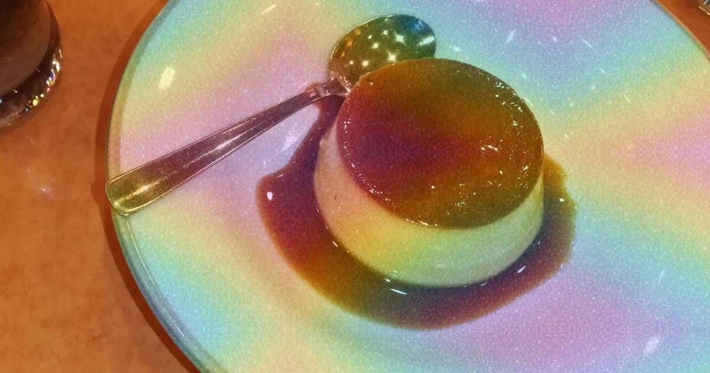

# ゲーミング加工
写真上の対象をなぞって選び、元画像全体を下に残し、同じ座標の対象にラメを半透明合成するブラウザアプリ。WebP・PNG・JPEG・MP4を保存できる。元のCutout-AIリポジトリには変更を加えず、独立した静的サイトとして配置する。

## ソースとライセンス
既存UIと選択編集の原典: https://github.com/DaisukeDaisuke/Cutout-AI （取得元コミット79f29739808f86b26089493b5053b613688de700、MIT）。ランタイムでこのリポジトリに依存しない。元のMIT表記をLICENSEに保持する。IMG.LYを利用する追加コードはAGPL-3.0で提供し、サイトから対応ソースZIPを取得できる。IMG.LYのライセンス本文はdist/licenses/AGPL-3.0.txt、mp4-muxerのMIT表記はdist/vendor/mp4-muxer-LICENSE.txt。mp4-muxerはコミット0ab3652250f12e97dde4927b4ddcb2c2f2891197のbuild/mp4-muxer.mjsをそのまま同梱する。
ラメ素材はユーザー提供のCC0虹色画像を色の参考に画像生成したもの。素材自体は変更せず同梱し、MP4・PNG共通の描画処理で細粒化と継ぎ目処理を行う。生成指示: 虹色の斜めグラデーションを保ち、全面を細かなホログラム金属ラメへ変換。文字・枠・物体・大きな星を追加しない。
参考: https://www.itmedia.co.jp/news/article/2604/09/1260409108/ 、https://github.com/imgly/background-removal-js 、https://github.com/Vanilagy/mp4-muxer
